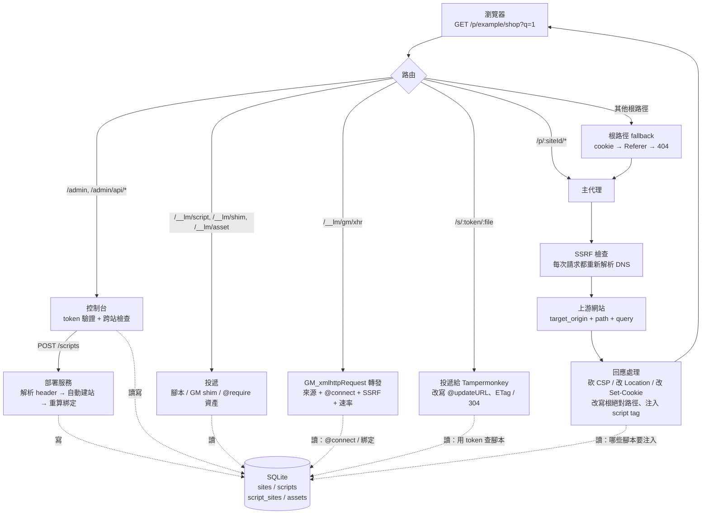

# LocalMonkey 🐒

**自架油猴。讓網站變成你想要的樣子 —— 而且任何裝置打開網址就有。**

油猴腳本很好用，但它活在**瀏覽器擴充功能**裡。這代表：手機 Safari 沒有、平板沒有、家裡那台電視盒的瀏覽器沒有、別人的電腦沒有。你改了一支腳本，還要一台一台同步。

LocalMonkey 把這件事搬到伺服器端：它是一個 **reverse proxy**，代理你指定的網站，並在回應的 HTML 裡注入你自己的 JS。

```
手機 / 平板 / 任何瀏覽器
        │
        ▼
http://你的機器:30600/p/ptt/        ← 打開這個網址就是改造後的網站
        │
   LocalMonkey（注入你的 JS）
        │
        ▼
   https://www.ptt.cc            ← 真正的網站
```

- **不用在每台裝置安裝任何東西。** 打開代理網址就有。
- **腳本集中管理、集中生效。** 改一次，所有裝置下次載入就是新版。
- **不需要重新部署。** 後台存檔就生效（腳本是 `no-cache`，而承載它的 HTML 是 `no-store`）。
- **直接吃 Tampermonkey 腳本。** 把 `.user.js` 丟進控制台，它自己讀 header 判斷
  要配哪些網域、自己建站、自己掛上去。`@match`、`@grant`、`@run-at`、`@require`
  都看得懂。

```
┌─ LocalMonkey ─────────────── [腳本] [網站] ───────── + 丟腳本 ─┐
│ ┌────────────────┬──────────────────────────────────────────┐ │
│ │ ● 蝦皮去廣告 2.1│ 兩站通用：深色 + 記次數        [儲存] ●啟用│ │
│ │ ○ 深色模式   1.0│ ──────────────────────────────────────── │ │
│ │ ● abc        0.3│ 配對  www.example.com · seller.shopee.tw │ │
│ │                │ 權限  GM_addStyle ✓  GM_setValue ✓       │ │
│ │                │ 時機  document-start                     │ │
│ │                │ ──────────────────────────────────────── │ │
│ │                │  1 // ==UserScript==                     │ │
│ │                │  2 // @name  兩站通用                     │ │
│ │                │    ⋯ CodeMirror（行號、高亮、括號配對）    │ │
│ └────────────────┴──────────────────────────────────────────┘ │
└──────────────────────────────────────────────────────────────┘
```

**資訊列（配對／權限／時機）是唯讀的**，跟著你打字即時從 userscript header
重新解析。要改配對就改 header —— 單一真相來源，不做第二個輸入口。

---

## 兩種模式（每支腳本各自選）

同一份腳本，LocalMonkey 可以用兩種方式送出去：

| | **代理模式** | **投遞模式** |
|---|---|---|
| 怎麼跑 | 打代理網址 `/p/<站>/`，由伺服器把腳本注入 HTML | Tampermonkey 從 `/s/<token>/…user.js` 裝起來，跑在原站 |
| 需要擴充功能 | **不用** —— 手機、平板、別人的電腦都行 | 要裝 Tampermonkey |
| `GM_*` | 靠 LocalMonkey 的 shim（支援清單見下） | 原生，全部支援 |
| 要登入的站 / 複雜 SPA | 多半會壞（代理擋不住它們的 origin 檢查） | 正常 |
| `@match *://*/*` | 做不到（反向代理必須指向具體主機） | 可以 |
| 改一次全生效 | 下次載入頁面就是新版 | 各裝置的 Tampermonkey 自動更新 |

**所以「這支腳本不能代理」不等於「不能用」。** 控制台會分開告訴你這兩件事：
某個 `@match` 配不出具體主機時，它會說「不能用代理模式（原因…），但可以用投遞模式」。

### 投遞模式：讓 Tampermonkey 自動更新

每支腳本都有一組安裝網址（控制台的「安裝」那一列可以複製／直接開）：

```
http://你的機器:30600/s/<32 bytes 的隨機 token>/my-script.user.js
```

- 在任何裝置上開這個網址，Tampermonkey 會跳出安裝畫面
- 之後你在控制台改腳本、存檔，**各裝置就會自己更新**
- 這個端點**免認證**（Tampermonkey 抓腳本時帶不了 token），憑證就是路徑裡那組猜不到的
  token。要撤銷就按「重新產生網址」（已安裝的裝置要重裝）
- 投遞出去的那一份會把 `@updateURL` / `@downloadURL` 改寫成這個網址，所以更新檢查
  會回到 LocalMonkey —— 腳本原本寫的更新來源不會被沿用

> ⛔ **Tampermonkey 只有在遠端 `@version` 比本地高時才更新。** 你改完存檔但沒動版本號
> 的話，所有裝置都會停在舊版 —— 看起來就像功能壞了。所以存檔後控制台會明確告訴你
> 「版本號沒變，Tampermonkey 不會更新到這一版」，旁邊給你一顆**版本 +1 並儲存**。
> 沒有 `@version` 的腳本也會被提醒：那種腳本永遠不會自動更新。

---

## 刻意不做的事

這個專案的價值在於**簡單到不行卻很實用**。以下功能屬於姊妹專案 LocalDevTool，不會加進來：

- 流量記錄 / Network Inspector
- Playwright / CDP 自動化
- 右鍵挖掘、API 分析、影片來源追蹤

也不做：批量抓取、下載器、**繞過付費牆**。LocalMonkey 改的是「已經送到你瀏覽器的那份 HTML」，不是幫你拿你本來拿不到的東西。

---

## 安裝

需要 **Node 24+**（開發與驗證環境是 v24.16.0）。

```bash
git clone https://github.com/Jeffrey0117/LocalMonkey.git
cd LocalMonkey
npm install
npm start
```

啟動後 log 會長這樣：

```
2026-11-16T10:19:57.487Z [info ] 已產生新的後台 token（也存在 C:\...\LocalMonkey\data\admin-token.txt）：fccba58d...
2026-11-16T10:19:57.496Z [info ] LocalMonkey 聽在 http://127.0.0.1:30600
2026-11-16T10:19:57.496Z [info ] 後台：http://127.0.0.1:30600/admin
```

把 token 貼進網址開一次後台，瀏覽器就會記住（cookie）：

```
http://127.0.0.1:30600/admin?token=<你的 token>
```

> 開完會自動 302 到乾淨的 `/admin`，網址列不會留著 token。

### 從 v1 升級

直接 `git pull` + `npm start` 就好，schema migration 會自己跑（`PRAGMA user_version` 1 → 3）：

- v1 的腳本程式碼搬進 `scripts.source`，`match_glob` 變成 `script_sites` 的綁定
- `run_at` 的 `head-end` → `document-start`、`body-end` → `document-end`
- 網站與啟用狀態原樣保留
- 每支腳本會被補上一組投遞 token（安裝網址），既有的 token 不會被換掉

v1 的腳本沒有 userscript header，所以 metadata 是空的（會標成 `legacy`）——
在控制台裡幫它補上 `// ==UserScript==` 區塊並存檔，就會變成完整的 v2 腳本。
v1 的後台 API 也還在（見下面的「相容路徑」）。

---

## 60 秒丟進第一支腳本

1. 開 `http://127.0.0.1:30600/admin?token=<token>`
2. 按右上角 **+ 丟腳本**，把下面這段貼進去（或直接把 `.user.js` 檔拖到框裡）：

   ```js
   // ==UserScript==
   // @name        Example 深色模式
   // @version     1.0
   // @match       https://example.com/*
   // @run-at      document-start
   // @grant       GM_addStyle
   // ==/UserScript==

   GM_addStyle('body { background: #111; color: #eee }');
   document.title = 'LocalMonkey was here';
   ```

3. 下面會即時列出**偵測到的網域**，每一列標著能不能代理與原因：

   | 狀態 | 來源 pattern | 要代理的主機 | 路徑 |
   |---|---|---|---|
   | 可代理 | `https://example.com/*` | `https://example.com` | `*` |

4. 按 **部署**。網站（slug `example-com`）會自己長出來，腳本也掛上去了。
5. 到 **網站** 分頁按 **複製**，用任何裝置打開 `http://<你的機器 IP>:30600/p/example-com/`

> 之後改腳本就在左邊點那支、直接改、`Ctrl+S`。改到 `@match` 的話，網站與綁定
> 會跟著重算（拿掉的網域會自動解綁）。

同樣的事用 curl 做（CI 或腳本裡會用到）—— **只要給 source，其他全部從 header 推**：

```bash
TOKEN=$(cat data/admin-token.txt)

# 先看它會判斷成什麼（不寫入）
curl -s -X POST http://127.0.0.1:30600/admin/api/userscript/parse \
  -H "Authorization: Bearer $TOKEN" -H 'content-type: application/json' \
  -d '{"source":"// ==UserScript==\n// @name demo\n// @match https://example.com/*\n// ==/UserScript==\ndocument.title=\"x\";"}'

# 真的部署
curl -s -X POST http://127.0.0.1:30600/admin/api/scripts \
  -H "Authorization: Bearer $TOKEN" -H 'content-type: application/json' \
  -d '{"source":"// ==UserScript==\n// @name demo\n// @match https://example.com/*\n// ==/UserScript==\ndocument.title=\"x\";"}'

curl -s http://127.0.0.1:30600/p/example-com/ | grep __lm
# → <script src="/__lm/script/scr_6ab04c06d6529379.js"></script>
```

---

## 架構



### 一個請求實際發生的事

| 階段 | 做了什麼 |
|---|---|
| 路由 | `/admin`、`/admin/api/*`、`/__lm/*`、`/s/*` 是保留路徑，不進代理。site slug 也不准叫這些名字 |
| siteId | 主路由從 `/p/:siteId/` 拿；fallback 依序試 cookie `lm_site` → `Referer` 裡的 `/p/<id>/` → 都沒有就 404（**不是 502**，502 會讓人以為代理壞了） |
| SSRF | 解析 `target_origin` 的 DNS，命中 loopback / 私網 / link-local / `metadata.google.internal` 就 403 |
| 請求 | 原樣轉送 method、body、cookie、UA、accept\*；移除 hop-by-hop 與 `host`、`content-length`、`accept-encoding` |
| 回應 | 丟掉 `content-security-policy`、`x-frame-options`、`content-encoding`、`strict-transport-security`、`cross-origin-*`…（CSP 會擋掉注入；`content-encoding` 與已解壓的 body 不符） |
| 3xx | `Location` 指向上游自己 → 改寫成 `/p/<id>/…`；指向別的網域 → 原樣保留 |
| Set-Cookie | 拿掉 `Domain=`、拿掉 `Secure`、`SameSite` 改 `Lax`，多條逐條處理（不合併） |
| HTML | 保守改寫根絕對路徑 → 注入 `<script src="…">`：`document-start` 插在 `<head>` 的第一個子元素、`document-end` / `document-idle` 在 `</body>` 前（v1 的 `head-end` 維持在 `</head>` 前），依 `order_index` 排序。每支腳本的順序是 GM shim → `@require` 資產 → 腳本本身 |
| 非 HTML | 原樣回傳 buffer（圖片、JS、CSS 都是 byte-for-byte） |

### 檔案地圖

```
src/
  index.js              進入點：config → DB → token → listen
  app.js                組 express app（路由順序都在這）
  config.js             env → 設定物件（全部有預設值）
  logger.js             小 logger（分級、寫 stdout/stderr）
  userscript/           ★ userscript header 的解析（純函式，不碰 DB/網路）
    metadata.js         抓 // @key value
    match.js            @match → (主機, 路徑 glob) 的語意轉換
    grants.js           @grant 支援清單與識別字濾網
    parse.js            把上面組成一份解析結果
  db/
    index.js            開 DB + 跑 migration
    migrations.js       PRAGMA user_version 的單向 migration（v1 → v2）
    sites.js            sites repository
    userscripts.js      ★ v2：腳本本體 + script_sites 綁定
    scripts.js          v1 的相容投影（code / site_id / match_glob）
    assets.js           ★ @require / @resource 的內容定址快取
    store.js            把 repository 綁上同一個 db handle
    errors.js           DuplicateIdError / NotFoundError
  services/
    deploy.js           ★ 解析 → 自動建站 → 重算綁定 → 抓資產
    site-slug.js        主機名 → 代理網址用的 slug
    fetch-asset.js      抓 @require（SSRF + 大小上限）
    gm-forward.js       ★ GM_xmlhttpRequest 的實際轉發
    delivery.js         ★ 投遞模式：token、header 改寫、版本號
  lib/
    glob.js             path_glob 比對（* ** ?）
    injection.js        ★ 這一頁要注入什麼、插在哪裡
    html.js             根絕對路徑改寫、三個注入點
    user-script.js      包 try/catch、宣告 GM_* 區域變數、document-idle 排程
    gm-shim.js          ★ shim 的伺服器端（組 config + render）
    connect-policy.js   ★ @connect 白名單判斷
    rate-limit.js       ★ 滑動視窗速率限制
    gm-allow-hosts.js   ★ GM_xmlhttpRequest 的本機目標白名單
    read-capped.js      ★ 有上限地讀 fetch 回應
    validate.js         零依賴輸入驗證
    ssrf.js             origin → DNS → 內網判斷
    ip.js               IPv4/IPv6 位址分類（fail closed）
    headers.js          請求/回應 header 過濾
    cookies.js          Set-Cookie 改寫、Cookie 解析
    location.js         3xx Location 改寫
    site-resolve.js     cookie / Referer → siteId
    ids.js              id 產生與時間戳
  proxy/
    handler.js          兩個入口（主路由 / fallback）共用的管線
    forward.js          組上游 URL + fetch
    respond.js          回應改寫與送出
    body.js             讀請求 body（有大小上限）
  routes/
    admin-page.js       /admin 控制台 + ?token= 登入
    admin-api.js        /admin/api/* REST（v2 + v1 相容）
    internal.js         /__lm/script|shim|asset
    gm-xhr.js           ★ POST /__lm/gm/xhr（七道防護）
    delivery.js         ★ GET /s/<token>/<slug>.user.js
  middleware/
    admin-auth.js       token 驗證 + 跨站寫入阻擋
  views/pages.js        錯誤頁（給人看的，不吐堆疊）
  public/               控制台 UI（原生 HTML/CSS/JS，沒有 build step）
    index.html          骨架
    app.css             深色、吃滿寬度
    ui.js api.js        小工具 / API 呼叫層
    info-bar.js         唯讀資訊列
    editor.js           CodeMirror 包裝（載不起來就退回 textarea）
    scripts-tab.js      清單 + 編輯器
    sites-tab.js        網站唯讀清單
    drop-script.js      「+ 丟腳本」的解析與部署
    gm-shim.js          ★ 真的跑在被代理頁面上的 GM shim
    vendor/             CodeMirror 5（單一檔案 + CSS + MIT 授權）
tests/
  unit/                 純函式
  integration/          真的起 server + 真的假上游，對打 fetch
  support/              測試 harness（假上游、app、raw HTTP、假 DOM）
```

---

## 後台 API

全部需要 `Authorization: Bearer <token>` 或 cookie `lm_admin`。

### 腳本（v2：只給 source，其他從 header 推）

| Method | Path | 說明 |
|---|---|---|
| POST | `/admin/api/userscript/parse` | `{ source }` → 只解析不寫入（預覽與資訊列用） |
| GET | `/admin/api/scripts` | 列表（不含 `source`，帶 `site_ids`） |
| POST | `/admin/api/scripts` | `{ source }` → 解析 + 自動建站 + 綁定 → `{ script, targets, warnings }` |
| GET | `/admin/api/scripts/:id` | 單支（含 `source`、`metadata`、`sites`） |
| PUT | `/admin/api/scripts/:id` | 帶 `source` → 重新解析並重算綁定；只帶 `enabled` / `order_index` → 單純更新。帶 `bumpVersion: true` 會先把 `@version` 最後一段 +1。回應帶 `versionBumped` |
| DELETE | `/admin/api/scripts/:id` | 刪除 |
| POST | `/admin/api/scripts/:id/delivery-token/rotate` | 重新產生安裝網址（撤銷舊的） |
| GET | `/admin/api/settings` | 控制台要用的伺服器設定（GM 白名單、allowPrivate） |

`targets` 是「偵測到的網域表」，每一列有 `status`（`ready` / `needs-host` / `rejected`）、
`host`、`targetOrigin`、`pathGlob`、`siteId` 與 `reason`。

### 網站（唯讀清單）

| Method | Path | 說明 |
|---|---|---|
| GET | `/admin/api/sites` | 列出網站，含 `scripts`（掛著哪些腳本）、`auto_created`、`from_pattern` |
| PATCH | `/admin/api/sites/:id` | 只准改 `name` / `target_origin` / `enabled` |
| POST | `/admin/api/sites` | 手動建站（保留；需要 `id`、`name`、`target_origin`） |
| GET | `/admin/api/sites/:id` | 單一網站 |
| PUT | `/admin/api/sites/:id` | 同 PATCH |
| DELETE | `/admin/api/sites/:id` | 刪除（只掛在它身上的腳本會跟著走，還掛在別站的留著） |

### v1 的相容路徑（仍然有效）

| Method | Path | 說明 |
|---|---|---|
| GET | `/admin/api/sites/:id/scripts` | 該網站的腳本（v1 形狀） |
| POST | `/admin/api/sites/:id/scripts` | 新增一支純 JS（`name`、`code`、`match_glob`、`run_at`、`order_index`） |
| PUT | `/admin/api/scripts/:id` | 帶 v1 欄位（`code` / `match_glob` / `run_at`…）時走這條 |

v1 的 `run_at` 兩個值（`head-end` / `body-end`）仍然合法，注入位置與 v1 完全一樣。

錯誤格式：

```json
{ "error": "validation_failed", "details": [{ "field": "target_origin", "message": "…" }] }
```

`error` 可能是 `validation_failed`、`ssrf_blocked`、`duplicate_id`、`not_found`、`invalid_json`、`unauthorized`、`cross_site_blocked`、`internal_error`。

### path_glob

比對的是**代理後的 path**（不含 query）：

| pattern | 意思 |
|---|---|
| `*` | 所有頁面（特例：單獨一個 `*` 就是 match-all） |
| `/shop/**` | `/shop/` 底下全部，含更深的層 |
| `/shop/*` | `/shop/` 的下一層（不跨 `/`） |
| `/page?.html` | `?` 比對單一個非 `/` 字元 |

---

## userscript header 怎麼被解讀

### `@match` → 網站 + 路徑

**Chrome match pattern 的路徑 `*` 會跨 `/`，LocalMonkey 的 glob 單星號不跨**，
所以路徑一定要做語意轉換 —— 照抄會變成腳本不執行或到處都執行，而且不報錯：

| `@match` 的路徑 | 轉成 `path_glob` |
|---|---|
| `/*` | `*`（match-all 特例） |
| `/items/*` | `/items/**` |
| `/a/*/b` | `/a/**/b` |
| `/exact` | `/exact` |
| *(沒有路徑)* | `*` |

主機的部分決定這一列的狀態：

| 主機樣式 | 狀態 | 行為 |
|---|---|---|
| `www.example.com` | `ready` | 直接建站，target `https://www.example.com` |
| `*.example.com` | `needs-host` | 先建 `example.com`，UI 標示「可以到網站分頁改成具體子網域」 |
| `*`、`<all_urls>`、`*://*/*` | `rejected` | 擋下來。反向代理必須指向具體主機，配全世界沒有意義 |

`*://` 視為 https；`http://` 照收但會標示不安全。`@include` 走同一條路但更寬鬆；
`/正則/` 形式只在「開頭就是字面 scheme + 字面主機」時才採用，抽不出來就 `rejected` —— 不猜。

`@exclude` / `@exclude_match` 會變成該綁定的排除規則，注入判斷時命中就整支不跑。

### `@run-at` → 注入位置

| `@run-at` | 注入位置 |
|---|---|
| `document-start` | **`<head>` 的第一個子元素** —— 在頁面自己的 `<script>` 之前，所以 hook `fetch` 有效 |
| `document-end`（預設） | `</body>` 之前 |
| `document-idle` | `</body>` 之前，外面包 `DOMContentLoaded` + `requestIdleCallback` |

### `@noframes` → 只在最上層頁面跑

宣告了就不會在 iframe 裡執行。判斷在瀏覽器端做（伺服器不知道這份 HTML 會不會被塞進
frame）：讀 `window.top` 丟錯當成在跨來源 frame 裡、不跑；完全讀不到 `window.top`
的環境當成最上層、照跑。

### `@updateURL` / `@downloadURL`

解析進 metadata 並顯示在控制台。投遞模式會**在送出去的那一份裡**把它們換成
LocalMonkey 的安裝網址（資料庫裡的 source 不動）。

### `@grant` → GM API

只有宣告過的 API 會出現在腳本的 scope 裡（跟 Tampermonkey 一致）。
`@grant none` 或完全沒宣告 → 不投遞 shim。

| API | 實作 |
|---|---|
| `unsafeWindow` | `window`（我們本來就在頁面 scope） |
| `GM_addStyle` | 塞一個 `<style>` 進 head，回傳該元素 |
| `GM_setValue` / `GM_getValue` / `GM_deleteValue` / `GM_listValues` | `localStorage`，key 前綴 `__lm_gm_<scriptId>_`，同步 |
| `GM.*`（GM4） | 同上但回 Promise |
| `GM_openInTab` | `window.open` |
| `GM_setClipboard` | `navigator.clipboard.writeText`，失敗回 `false` 並 warn |
| `GM_registerMenuCommand` | 右下角一顆浮動按鈕展開選單（`all: initial` 隔離樣式） |
| `GM_notification` | `Notification` API，沒權限就退回頁面內 toast |
| `GM_info` | 從 metadata 合成 |
| `GM_getResourceText` / `GM_getResourceURL` | 走伺服器端的 `assets` 快取 |
| `GM_download` | 先把檔案抓成 blob 再用 `<a download>` 存。**遠端網址不會直接丟給 `<a>`** —— 跨來源時瀏覽器會忽略 download 改成導航，等於把你正在看的頁面弄掉 |
| `GM_xmlhttpRequest` / `GM.xmlHttpRequest` | 走伺服器端轉發（見下） |

**沒實作的（`GM_cookie`、`GM_setValues`…）不會靜默失敗**：呼叫時會 `console.error`
說明，後台該腳本的權限列也會標紅字。shim 自己的任何錯誤都只進 `console.warn` ——
它絕不能弄壞被代理的原站。

### `@require` / `@resource`

存腳本時在**伺服器端**抓下來，用 sha256 內容定址存進 DB，投遞路徑
`/__lm/asset/<sha256>.js`，排在使用者腳本之前（照宣告順序）。

理由：離線可用、不會把你的瀏覽行為洩漏給 CDN、內容定址天然有完整性保證。
抓失敗不會擋住存檔 —— 腳本照樣存起來，後台把那條標成失效。

### `GM_xmlhttpRequest` 的伺服器端轉發

`POST /__lm/gm/xhr` 會讓伺服器**代替你**發請求，所以它鎖了七道：

1. **來源**：跨站請求擋掉；`Referer`（優先）或 `lm_site` cookie 必須對應到啟用中的網站
2. **`@connect`**：目標主機必須被腳本宣告過（網域也涵蓋子網域）。`@connect *` 一律拒絕。
   沒宣告 → 只准打站自己的 origin。另外要求 `@grant GM_xmlhttpRequest`
3. **SSRF**：解析 DNS 擋私網，**連每一跳轉址都重驗**
4. **method 白名單**：GET / POST / PUT / PATCH / DELETE / HEAD
5. **大小與逾時**：預設 10MB / 30s
6. **不轉送憑證**：送上游的 header 是白名單組出來的，不是把進來的請求複製一份 ——
   瀏覽器的 Cookie 與後台 token 結構上不可能外流。腳本自己帶的 `cookie` 只在打
   「站自己的 origin」時才送；回應的 `set-cookie` 濾掉
7. **速率限制**：每個網站各算各的（預設 60 次 / 分鐘）

#### 打自己機器上的後端（`LOCALMONKEY_GM_ALLOW_HOSTS`）

很多實用的腳本是在打你自己的服務（`@connect localhost` + `http://localhost:8001`）。
SSRF 防護會擋掉這種請求 —— 而且是最難除錯的那種失敗：**腳本看起來有跑，請求靜默失敗**。

所以有一份獨立的白名單：

```bash
LOCALMONKEY_GM_ALLOW_HOSTS=localhost:8001,127.0.0.1:8001
```

- 只影響 `/__lm/gm/xhr`，**不影響代理目標**（那是 `LOCALMONKEY_ALLOW_PRIVATE`，範圍大得多）
- **精確比對，含 port**：`localhost` 不等於 `localhost:8001`，不做萬用字元
- 命中只豁免「私網位址」那條；腳本的 `@connect` 還是要過（**兩道都要過**）
- 連 302 轉址的每一跳都重新比對 —— 白名單上的主機不能被當成跳板

> ⚠ 放行之後，被你代理的那些網頁就能透過 LocalMonkey 打到你內網的這些主機
> （只限列出來的 `host:port`，而且只有宣告過對應 `@connect` 的腳本能用）。
> 只列你自己的服務。

沒放行的時候**不會靜默失敗**：存檔時 `warnings` 會講、控制台的權限列會把那個
`@connect` 標成紅字「未放行」，並附上要設的 env。

---

## 設定

| 環境變數 | 預設 | 說明 |
|---|---|---|
| `PORT` | `30600` | 監聽的 port |
| `HOST` | `127.0.0.1` | 綁定位址。改 `0.0.0.0` 才能給同網段裝置用（⚠ 見下方安全） |
| `LOCALMONKEY_ADMIN_TOKEN` | *(產生)* | 後台 token。沒設就產生一把寫進 `data/admin-token.txt` |
| `LOCALMONKEY_DATA_DIR` | `./data` | SQLite 與 token 檔的位置 |
| `LOCALMONKEY_ALLOW_PRIVATE` | *(關)* | 設 `1` 才准代理內網位址 |
| `LOCALMONKEY_UPSTREAM_TIMEOUT_MS` | `20000` | 等上游的逾時 |
| `LOCALMONKEY_MAX_BODY_BYTES` | `26214400` | 代理請求 body 上限 |
| `LOCALMONKEY_LOG_LEVEL` | `info` | `silent`/`error`/`warn`/`info`/`debug` |
| `LOCALMONKEY_ASSET_TIMEOUT_MS` | `15000` | 抓 `@require` / `@resource` 的逾時 |
| `LOCALMONKEY_ASSET_MAX_BYTES` | `5242880` | 單一 `@require` 的大小上限 |
| `LOCALMONKEY_GM_XHR_TIMEOUT_MS` | `30000` | `GM_xmlhttpRequest` 等上游的逾時 |
| `LOCALMONKEY_GM_XHR_MAX_BYTES` | `10485760` | `GM_xmlhttpRequest` 回應大小上限 |
| `LOCALMONKEY_GM_XHR_MAX_REQUEST_BYTES` | `1048576` | 單次呼叫可以帶的 body 上限 |
| `LOCALMONKEY_GM_XHR_RATE` / `_WINDOW_MS` | `60` / `60000` | 每個網站的速率限制 |
| `LOCALMONKEY_GM_ALLOW_HOSTS` | *(空)* | 允許 `GM_xmlhttpRequest` 打的本機 `host:port`（精確比對，見上方說明） |

完整說明見 [`.env.example`](.env.example)。把它複製成 `.env` 就會生效（`npm start` 走 Node 內建的 `--env-file-if-exists`，不需要 dotenv，零依賴沒被打破）。真實環境變數優先於 `.env` 裡的值。

---

## 安全注意事項

這支服務的本質是「代理任意網址 + 執行任意 JS」，所以安全邊界要講清楚。

- **後台一律要 token。** 沒有 hardcoded 預設 token，也沒有「localhost 免驗證」。
  後者是刻意拒絕的設計：本機免驗證 + 寬鬆 CORS = 你瀏覽器裡**任何**網頁都能
  `fetch('http://127.0.0.1:30600/admin/api/sites')` 當你的管理員。
- **完全不設 CORS header。** 別的網站的 JS 讀不到後台 API 的回應。
- **跨站寫入直接 403。** `POST`/`PUT`/`PATCH`/`DELETE` 會檢查 `Sec-Fetch-Site`
  與 `Origin`；非瀏覽器（沒帶這兩個 header 的 curl / 腳本）放行，但照樣要 token。
- **token 比對用 `crypto.timingSafeEqual`**（長度不同先擋）。
- **SSRF 防護預設開著。** `target_origin` 只准 http/https；新增網站時**和每次代理請求時**
  都重新解析 DNS，命中 loopback、`10/8`、`172.16/12`、`192.168/16`、`169.254/16`、
  `0.0.0.0/8`、`::1`、`fc00::/7`、`fe80::/10`、`metadata.google.internal` 就拒絕。
- **`HOST=0.0.0.0` 等於把管理後台開給整個區網。** 擋在前面的只有那把 token，
  而且區網是 http：cookie 與 token 都是明文。只在你清楚 Wi-Fi 上有誰的時候這樣做。
- **腳本網址不是秘密。** `/__lm/script/<id>.js` 不需要 token（瀏覽器要匿名載它）。
  id 是 64-bit 隨機值，猜不到，但知道 id 的人就讀得到那支腳本的內容。別把密碼寫在腳本裡。
- **`Secure` 會被從 Set-Cookie 拿掉**（本機是 http，不拿掉瀏覽器根本不存）。
  代價是上游的 session cookie 在你的區網裡是明文走的。

---

## 已知限制

這些是設計上的取捨，不是還沒做完的 TODO。

1. **同一個瀏覽器同時開兩個代理網站會互搶 cookie。**
   根路徑 fallback 靠 cookie `lm_site` 判斷「`/assets/app.js` 是誰的」，而 cookie 只有一個。
   A 站的 HTML 回應會把 `lm_site` 設成 A，B 站會設成 B —— 兩邊都開著的時候，後載入的那個贏，
   另一邊的根路徑資源就會抓錯網站。**解法是一次只開一個**（或替每個網站開一個 LocalMonkey 實例）。
2. **JS 動態組出來的跨域請求不經過代理。** 頁面自己 `fetch('https://api.example.com/…')`
   會直接打到真網站（而且因為是跨域，常常直接被瀏覽器的 CORS 擋掉）。
   LocalMonkey 只改 HTML 裡的路徑，不改 JS 裡的字串。
3. **HTML 改寫是保守的：只處理「被引號包起來」的屬性值。**
   真實案例：今天的 `example.com` 用的是 `<script src=/s.js>`（沒有引號），這種不會被改寫。
   它仍然能運作 —— 瀏覽器會打 `/s.js`，由根路徑 fallback 靠 cookie 接住。
   這也是為什麼 fallback 不只是「保險」，而是必要元件。
4. **不代理 WebSocket。** `/ws` 這種升級請求不會被轉送。
5. **SSRF 檢查是 check-then-connect。** 我們解析 DNS、確認不是內網，然後才 fetch ——
   但 fetch 會自己再解析一次。兩次之間有一個很窄的 TOCTOU 窗口（要 pin 住 IP 得自己寫
   undici dispatcher，那會把零依賴的簡單性吃掉）。每次請求都檢查已經擋掉了實際可行的 rebinding 攻擊。
6. **每個代理請求都會做一次 DNS 查詢。** 作業系統的 DNS cache 會吸收大部分成本，但它不是零。
7. **代理自己只跑 http。** 沒有 TLS。它設計上是跑在你信任的網路裡。
8. **`<base href>` 與 meta refresh 只有「指向被代理的那個站」才會改寫。**
   指向別的網域的保留原樣（那是真的跨網域意圖）。沒有引號的 `<base href=…>`
   也不會被改寫 —— 同第 3 點的保守規則，但這一種**沒有 fallback 接得住**
   （base 會讓整頁的相對路徑一起偏掉）。實務上沒遇過，遇到就得放寬那條規則。
8. **把自己的 origin 寫死在 JS 裡的網站會逃出代理**（例如 `location.href = 'https://www.example.com/x'`）。
   這種要自己寫一支腳本把它改回來 —— 這正是 LocalMonkey 存在的用途。
9. **HTML 改寫走 latin1 來回轉換**，所以不管頁面是 UTF-8 還是 Big5，沒被我們改到的 byte 都原封不動。
   代價是我們不碰 charset 宣告，也不做編碼轉換。
10. **不是繞付費牆的工具。** 伺服器拿不到的東西，注入 JS 也拿不到。
11. **腳本之間沒有沙箱隔離。** GM_* 是每支腳本自己的（各自的 scope、各自的
    `localStorage` 命名空間），但它們都跑在頁面的 JS 環境裡，看得到彼此改過的 DOM
    與全域變數。Tampermonkey 的 `@sandbox` 沒有對應實作。
12. **`GM_getResourceText` 的內容是存檔時嵌進去的**（因為它是同步 API）。
    超過 256KB 或不是文字型的資源只給 `GM_getResourceURL`，`GM_getResourceText` 回 `null` 並 warn。
13. **`@require` 抓到的東西不會自動更新。** 同一個 URL 只抓一次（內容定址），
    CDN 上的內容改了也不會重抓 —— 要換就改 URL。
14. **從 v1 升級上來的腳本 metadata 是空的。** migration 保住了程式碼與綁定，
    但沒有重新解析（migration 不該依賴會演化的解析器）。那些腳本在控制台裡存一次檔就會補上。
15. **`@connect` 只比對主機，不比對路徑或 port。** 跟 Tampermonkey 一樣的粒度。
16. **投遞模式沒有伺服器推送更新。** 靠 Tampermonkey 自己的週期性檢查（也可以在它的
    管理頁按「檢查更新」）。也沒有腳本市集、沒有簽章。
17. **安裝網址的 token 就是憑證。** 那個端點免認證（Tampermonkey 帶不了 header），
    所以網址洩漏＝腳本內容洩漏。按「重新產生網址」可以撤銷，但已安裝的裝置要重裝。

---

## 測試

```bash
npm test            # 全部
npm run test:coverage
```

用 Node 內建的 `node:test`，沒有裝測試框架。整合測試**真的把 server 起在 port 0**，
並且用一個同樣跑在 port 0 的假上游對打（不 mock `fetch`，不然測不到真東西）。
GM shim 則是放進自己寫的假 DOM（`tests/support/dom.js`）**真的執行**，不是比對字串。

最近一次執行：

```
ℹ tests 673
ℹ pass 673
ℹ fail 0

ℹ all files         |  97.53 |    90.44 |   97.93 |
```

（line % / branch % / funcs %）

前端是瀏覽器程式，這裡測不到互動 —— 但「會整個壞掉卻無聲」的兩種狀況有釘住：
每支前端 JS 都要能被 `vm.Script` 解析、`index.html` 引用的每個資源都要真的回 200。

---

## 疑難排解

**`Could not locate the bindings file`（better-sqlite3）**
npm 12 預設擋掉依賴的 install script，所以 `better-sqlite3` 不會去下載 prebuilt binary。
本專案的 `postinstall` 會自動補救；手動補的話：

```bash
npm run fix:sqlite
```

這台機器沒有 MSVC，所以「下載 prebuilt」是唯一的路 —— 也是為什麼 `better-sqlite3`
鎖在 `^12`（13 起拿掉了 prebuild-install，只剩 `node-gyp` 編譯）。

**`EADDRINUSE` / port 被占用**
換一個 port：`PORT=30601 npm start`。要找出誰占著 30600（Windows）：

```powershell
Get-NetTCPConnection -LocalPort 30600 -State Listen |
  ForEach-Object { Get-CimInstance Win32_Process -Filter "ProcessId=$($_.OwningProcess)" } |
  Select-Object ProcessId, Name, CommandLine
```

**代理頁面是 502**
錯誤頁上會寫目標是誰、錯誤代碼是什麼、常見原因有哪些。真實原因（含堆疊）在伺服器的 log 裡。

**腳本改了沒生效**
正常情況不該發生：代理回的 HTML 一律 `Cache-Control: no-store`，腳本本身是 `no-cache`。
**例外是 2026-11-17 之前就被快取起來的頁面** —— 那時我們還原樣沿用上游的
`max-age`，瀏覽器可能存了一份要放到隔天才過期。那種情況強制重新載入一次（Ctrl+F5）
或開無痕分頁就好，之後不會再發生。

---

## 授權

MIT
