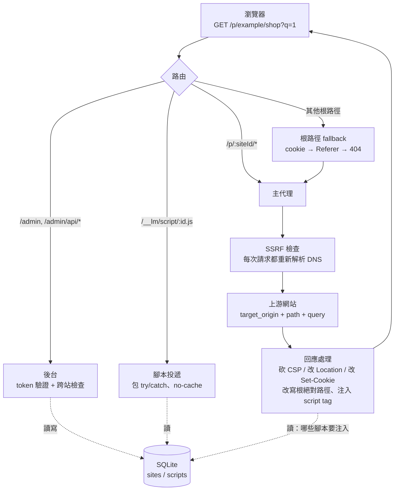

# LocalMonkey 🐒

**自架油猴。讓網站變成你想要的樣子 —— 而且任何裝置打開網址就有。**

油猴腳本很好用，但它活在**瀏覽器擴充功能**裡。這代表：手機 Safari 沒有、平板沒有、家裡那台電視盒的瀏覽器沒有、別人的電腦沒有。你改了一支腳本，還要一台一台同步。

LocalMonkey 把這件事搬到伺服器端：它是一個 **reverse proxy**，代理你指定的網站，並在回應的 HTML 裡注入你自己的 JS。

```
手機 / 平板 / 任何瀏覽器
        │
        ▼
http://你的機器:30600/p/ptt/        ← 打開這個網址就是改造後的網站
        │
   LocalMonkey（注入你的 JS）
        │
        ▼
   https://www.ptt.cc            ← 真正的網站
```

- **不用在每台裝置安裝任何東西。** 打開代理網址就有。
- **腳本集中管理、集中生效。** 改一次，所有裝置下次載入就是新版。
- **不需要重新部署。** 後台新增網站與腳本，立刻生效（腳本是 `no-cache`）。

---

## 刻意不做的事

這個專案的價值在於**簡單到不行卻很實用**。以下功能屬於姊妹專案 LocalDevTool，不會加進來：

- 流量記錄 / Network Inspector
- Playwright / CDP 自動化
- 右鍵挖掘、API 分析、影片來源追蹤

也不做：批量抓取、下載器、**繞過付費牆**。LocalMonkey 改的是「已經送到你瀏覽器的那份 HTML」，不是幫你拿你本來拿不到的東西。

---

## 安裝

需要 **Node 24+**（開發與驗證環境是 v24.16.0）。

```bash
git clone https://github.com/Jeffrey0117/LocalMonkey.git
cd LocalMonkey
npm install
npm start
```

啟動後 log 會長這樣：

```
2026-11-16T10:19:57.487Z [info ] 已產生新的後台 token（也存在 C:\...\LocalMonkey\data\admin-token.txt）：fccba58d...
2026-11-16T10:19:57.496Z [info ] LocalMonkey 聽在 http://127.0.0.1:30600
2026-11-16T10:19:57.496Z [info ] 後台：http://127.0.0.1:30600/admin
```

把 token 貼進網址開一次後台，瀏覽器就會記住（cookie）：

```
http://127.0.0.1:30600/admin?token=<你的 token>
```

> 開完會自動 302 到乾淨的 `/admin`，網址列不會留著 token。

---

## 60 秒做出第一支腳本

1. 開 `http://127.0.0.1:30600/admin?token=<token>`
2. **新增網站**：
   - `id` → `example`（這是網址用的 slug，只能小寫英數與連字號）
   - `名稱` → `Example Domain`
   - `target_origin` → `https://example.com`
3. 按該網站的 **管理腳本** → **新增腳本**：
   - `名稱` → `換掉標題`
   - `程式碼` →
     ```js
     const target = document.querySelector('h1') || document.querySelector('p');
     if (target) target.textContent = 'LocalMonkey was here';
     ```
   - 執行時機留 `body-end`、`match_glob` 留 `*`
4. 按網站卡片上的 **複製** 拿到代理網址，用任何裝置打開 `http://<你的機器 IP>:30600/p/example/`

同樣的事用 curl 做（CI 或腳本裡會用到）：

```bash
TOKEN=$(cat data/admin-token.txt)

curl -X POST http://127.0.0.1:30600/admin/api/sites \
  -H "Authorization: Bearer $TOKEN" -H 'content-type: application/json' \
  -d '{"id":"example","name":"Example Domain","target_origin":"https://example.com"}'

curl -X POST http://127.0.0.1:30600/admin/api/sites/example/scripts \
  -H "Authorization: Bearer $TOKEN" -H 'content-type: application/json' \
  -d '{"name":"replace-h1","code":"document.querySelector(\"h1\").textContent = \"LocalMonkey was here\";"}'

curl http://127.0.0.1:30600/p/example/ | tail -3
# → ...<script src="/__lm/script/scr_6ab04c06d6529379.js"></script>
```

---

## 架構



### 一個請求實際發生的事

| 階段 | 做了什麼 |
|---|---|
| 路由 | `/admin`、`/admin/api/*`、`/__lm/*` 是保留路徑，不進代理。site slug 也不准叫這些名字 |
| siteId | 主路由從 `/p/:siteId/` 拿；fallback 依序試 cookie `lm_site` → `Referer` 裡的 `/p/<id>/` → 都沒有就 404（**不是 502**，502 會讓人以為代理壞了） |
| SSRF | 解析 `target_origin` 的 DNS，命中 loopback / 私網 / link-local / `metadata.google.internal` 就 403 |
| 請求 | 原樣轉送 method、body、cookie、UA、accept\*；移除 hop-by-hop 與 `host`、`content-length`、`accept-encoding` |
| 回應 | 丟掉 `content-security-policy`、`x-frame-options`、`content-encoding`、`strict-transport-security`、`cross-origin-*`…（CSP 會擋掉注入；`content-encoding` 與已解壓的 body 不符） |
| 3xx | `Location` 指向上游自己 → 改寫成 `/p/<id>/…`；指向別的網域 → 原樣保留 |
| Set-Cookie | 拿掉 `Domain=`、拿掉 `Secure`、`SameSite` 改 `Lax`，多條逐條處理（不合併） |
| HTML | 保守改寫根絕對路徑 → 注入 `<script src="/__lm/script/<id>.js">`（`head-end` 在 `</head>` 前、`body-end` 在 `</body>` 前，依 `order_index` 排序） |
| 非 HTML | 原樣回傳 buffer（圖片、JS、CSS 都是 byte-for-byte） |

### 檔案地圖

```
src/
  index.js              進入點：config → DB → token → listen
  app.js                組 express app（路由順序都在這）
  config.js             env → 設定物件（全部有預設值）
  logger.js             小 logger（分級、寫 stdout/stderr）
  db/
    index.js            開 DB + 跑 migration
    migrations.js       PRAGMA user_version 的單向 migration
    sites.js            sites repository
    scripts.js          scripts repository
    store.js            把 repository 綁上同一個 db handle
    errors.js           DuplicateIdError / NotFoundError
  lib/
    glob.js             match_glob 比對（* ** ?）
    validate.js         零依賴輸入驗證
    ssrf.js             origin → DNS → 內網判斷
    ip.js               IPv4/IPv6 位址分類（fail closed）
    headers.js          請求/回應 header 過濾
    cookies.js          Set-Cookie 改寫、Cookie 解析
    html.js             根絕對路徑改寫、腳本注入
    location.js         3xx Location 改寫
    site-resolve.js     cookie / Referer → siteId
    user-script.js      把使用者的 JS 包 try/catch
    ids.js              id 產生與時間戳
  proxy/
    handler.js          兩個入口（主路由 / fallback）共用的管線
    forward.js          組上游 URL + fetch
    respond.js          回應改寫與送出
    body.js             讀請求 body（有大小上限）
  routes/
    admin-page.js       /admin 單頁 UI + ?token= 登入
    admin-api.js        /admin/api/* REST
    internal.js         /__lm/script/:id.js
  middleware/
    admin-auth.js       token 驗證 + 跨站寫入阻擋
  views/pages.js        錯誤頁（給人看的，不吐堆疊）
  public/               後台 UI（原生 HTML/CSS/JS，沒有 build step）
tests/
  unit/                 純函式
  integration/          真的起 server + 真的假上游，對打 fetch
  support/              測試用的 harness（假上游、app、raw HTTP client）
```

---

## 後台 API

全部需要 `Authorization: Bearer <token>` 或 cookie `lm_admin`。

| Method | Path | 說明 |
|---|---|---|
| GET | `/admin/api/sites` | 列出網站 |
| POST | `/admin/api/sites` | 新增（`id`、`name`、`target_origin`、`enabled?`） |
| GET | `/admin/api/sites/:id` | 單一網站 |
| PUT | `/admin/api/sites/:id` | 更新（`name`、`target_origin`、`enabled`；不能改 `id`） |
| DELETE | `/admin/api/sites/:id` | 刪除（連帶刪掉它的腳本） |
| GET | `/admin/api/sites/:id/scripts` | 該網站的腳本，依 `order_index` 排序 |
| POST | `/admin/api/sites/:id/scripts` | 新增腳本 |
| GET | `/admin/api/scripts/:scriptId` | 單一腳本 |
| PUT | `/admin/api/scripts/:scriptId` | 更新 |
| DELETE | `/admin/api/scripts/:scriptId` | 刪除 |

腳本欄位：`name`、`code`（上限 1MB）、`enabled`、`match_glob`（預設 `*`）、`run_at`（`head-end` / `body-end`）、`order_index`。

錯誤格式：

```json
{ "error": "validation_failed", "details": [{ "field": "target_origin", "message": "…" }] }
```

`error` 可能是 `validation_failed`、`ssrf_blocked`、`duplicate_id`、`not_found`、`invalid_json`、`unauthorized`、`cross_site_blocked`、`internal_error`。

### match_glob

比對的是**代理後的 path**（不含 query）：

| pattern | 意思 |
|---|---|
| `*` | 所有頁面（預設值，特例：單獨一個 `*` 就是 match-all） |
| `/shop/**` | `/shop/` 底下全部，含更深的層 |
| `/shop/*` | `/shop/` 的下一層（不跨 `/`） |
| `/page?.html` | `?` 比對單一個非 `/` 字元 |

---

## 設定

| 環境變數 | 預設 | 說明 |
|---|---|---|
| `PORT` | `30600` | 監聽的 port |
| `HOST` | `127.0.0.1` | 綁定位址。改 `0.0.0.0` 才能給同網段裝置用（⚠ 見下方安全） |
| `LOCALMONKEY_ADMIN_TOKEN` | *(產生)* | 後台 token。沒設就產生一把寫進 `data/admin-token.txt` |
| `LOCALMONKEY_DATA_DIR` | `./data` | SQLite 與 token 檔的位置 |
| `LOCALMONKEY_ALLOW_PRIVATE` | *(關)* | 設 `1` 才准代理內網位址 |
| `LOCALMONKEY_UPSTREAM_TIMEOUT_MS` | `20000` | 等上游的逾時 |
| `LOCALMONKEY_MAX_BODY_BYTES` | `26214400` | 代理請求 body 上限 |
| `LOCALMONKEY_LOG_LEVEL` | `info` | `silent`/`error`/`warn`/`info`/`debug` |

完整說明見 [`.env.example`](.env.example)。把它複製成 `.env` 就會生效（`npm start` 走 Node 內建的 `--env-file-if-exists`，不需要 dotenv，零依賴沒被打破）。真實環境變數優先於 `.env` 裡的值。

---

## 安全注意事項

這支服務的本質是「代理任意網址 + 執行任意 JS」，所以安全邊界要講清楚。

- **後台一律要 token。** 沒有 hardcoded 預設 token，也沒有「localhost 免驗證」。
  後者是刻意拒絕的設計：本機免驗證 + 寬鬆 CORS = 你瀏覽器裡**任何**網頁都能
  `fetch('http://127.0.0.1:30600/admin/api/sites')` 當你的管理員。
- **完全不設 CORS header。** 別的網站的 JS 讀不到後台 API 的回應。
- **跨站寫入直接 403。** `POST`/`PUT`/`PATCH`/`DELETE` 會檢查 `Sec-Fetch-Site`
  與 `Origin`；非瀏覽器（沒帶這兩個 header 的 curl / 腳本）放行，但照樣要 token。
- **token 比對用 `crypto.timingSafeEqual`**（長度不同先擋）。
- **SSRF 防護預設開著。** `target_origin` 只准 http/https；新增網站時**和每次代理請求時**
  都重新解析 DNS，命中 loopback、`10/8`、`172.16/12`、`192.168/16`、`169.254/16`、
  `0.0.0.0/8`、`::1`、`fc00::/7`、`fe80::/10`、`metadata.google.internal` 就拒絕。
- **`HOST=0.0.0.0` 等於把管理後台開給整個區網。** 擋在前面的只有那把 token，
  而且區網是 http：cookie 與 token 都是明文。只在你清楚 Wi-Fi 上有誰的時候這樣做。
- **腳本網址不是秘密。** `/__lm/script/<id>.js` 不需要 token（瀏覽器要匿名載它）。
  id 是 64-bit 隨機值，猜不到，但知道 id 的人就讀得到那支腳本的內容。別把密碼寫在腳本裡。
- **`Secure` 會被從 Set-Cookie 拿掉**（本機是 http，不拿掉瀏覽器根本不存）。
  代價是上游的 session cookie 在你的區網裡是明文走的。

---

## 已知限制

這些是設計上的取捨，不是還沒做完的 TODO。

1. **同一個瀏覽器同時開兩個代理網站會互搶 cookie。**
   根路徑 fallback 靠 cookie `lm_site` 判斷「`/assets/app.js` 是誰的」，而 cookie 只有一個。
   A 站的 HTML 回應會把 `lm_site` 設成 A，B 站會設成 B —— 兩邊都開著的時候，後載入的那個贏，
   另一邊的根路徑資源就會抓錯網站。**解法是一次只開一個**（或替每個網站開一個 LocalMonkey 實例）。
2. **JS 動態組出來的跨域請求不經過代理。** 頁面自己 `fetch('https://api.example.com/…')`
   會直接打到真網站（而且因為是跨域，常常直接被瀏覽器的 CORS 擋掉）。
   LocalMonkey 只改 HTML 裡的路徑，不改 JS 裡的字串。
3. **HTML 改寫是保守的：只處理「被引號包起來」的屬性值。**
   真實案例：今天的 `example.com` 用的是 `<script src=/s.js>`（沒有引號），這種不會被改寫。
   它仍然能運作 —— 瀏覽器會打 `/s.js`，由根路徑 fallback 靠 cookie 接住。
   這也是為什麼 fallback 不只是「保險」，而是必要元件。
4. **不代理 WebSocket。** `/ws` 這種升級請求不會被轉送。
5. **SSRF 檢查是 check-then-connect。** 我們解析 DNS、確認不是內網，然後才 fetch ——
   但 fetch 會自己再解析一次。兩次之間有一個很窄的 TOCTOU 窗口（要 pin 住 IP 得自己寫
   undici dispatcher，那會把零依賴的簡單性吃掉）。每次請求都檢查已經擋掉了實際可行的 rebinding 攻擊。
6. **每個代理請求都會做一次 DNS 查詢。** 作業系統的 DNS cache 會吸收大部分成本，但它不是零。
7. **代理自己只跑 http。** 沒有 TLS。它設計上是跑在你信任的網路裡。
8. **把自己的 origin 寫死在 JS 裡的網站會逃出代理**（例如 `location.href = 'https://www.example.com/x'`）。
   這種要自己寫一支腳本把它改回來 —— 這正是 LocalMonkey 存在的用途。
9. **HTML 改寫走 latin1 來回轉換**，所以不管頁面是 UTF-8 還是 Big5，沒被我們改到的 byte 都原封不動。
   代價是我們不碰 charset 宣告，也不做編碼轉換。
10. **不是繞付費牆的工具。** 伺服器拿不到的東西，注入 JS 也拿不到。

---

## 測試

```bash
npm test            # 全部
npm run test:coverage
```

用 Node 內建的 `node:test`，沒有裝測試框架。整合測試**真的把 server 起在 port 0**，
並且用一個同樣跑在 port 0 的假上游對打（不 mock `fetch`，不然測不到真東西）。

最近一次執行：

```
ℹ tests 241
ℹ pass 241
ℹ fail 0

ℹ all files         |  97.23 |    91.86 |   97.27 |
```

（line % / branch % / funcs %）

---

## 疑難排解

**`Could not locate the bindings file`（better-sqlite3）**
npm 12 預設擋掉依賴的 install script，所以 `better-sqlite3` 不會去下載 prebuilt binary。
本專案的 `postinstall` 會自動補救；手動補的話：

```bash
npm run fix:sqlite
```

這台機器沒有 MSVC，所以「下載 prebuilt」是唯一的路 —— 也是為什麼 `better-sqlite3`
鎖在 `^12`（13 起拿掉了 prebuild-install，只剩 `node-gyp` 編譯）。

**`EADDRINUSE` / port 被占用**
換一個 port：`PORT=30601 npm start`。要找出誰占著 30600（Windows）：

```powershell
Get-NetTCPConnection -LocalPort 30600 -State Listen |
  ForEach-Object { Get-CimInstance Win32_Process -Filter "ProcessId=$($_.OwningProcess)" } |
  Select-Object ProcessId, Name, CommandLine
```

**代理頁面是 502**
錯誤頁上會寫目標是誰、錯誤代碼是什麼、常見原因有哪些。真實原因（含堆疊）在伺服器的 log 裡。

**腳本改了沒生效**
腳本本身是 `no-cache`，但**頁面** HTML 可能被瀏覽器快取住了。強制重新載入（Ctrl+F5）。

---

## 授權

MIT
